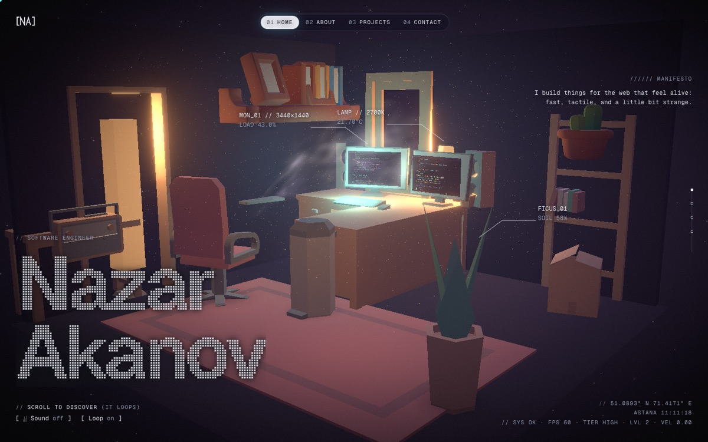
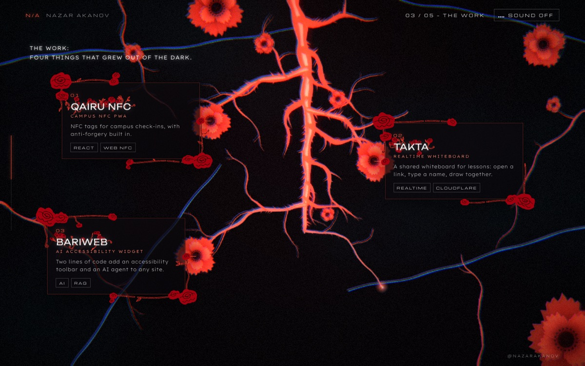
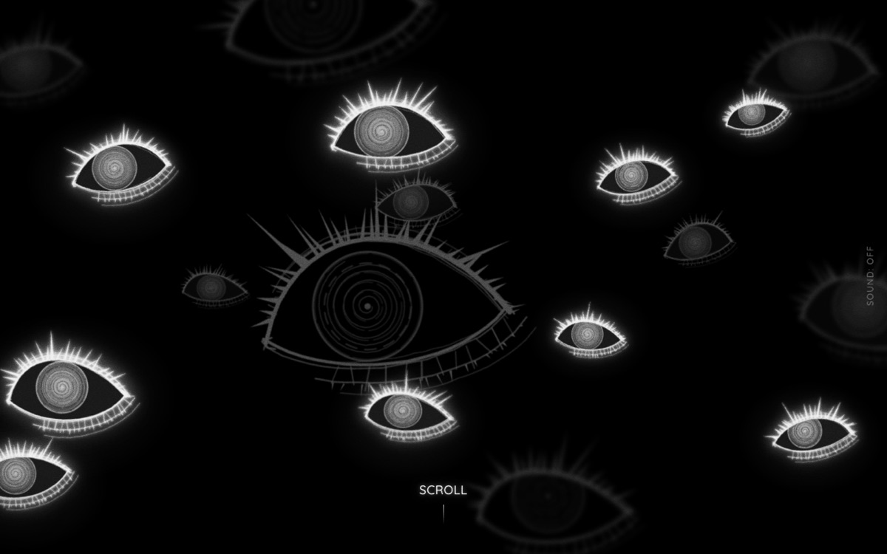

# portfolios

Every portfolio site I've built, in one repo, so you can read the code, run it and steal ideas.
Each folder is a full standalone project with its own `package.json` and README. They're numbered in the
order I made them.

| # | Folder | Idea | Stack | Live |
|---|---|---|---|---|
| 01 | [`01-infinite-3d`](01-infinite-3d) | igloo.inc-style endless scroll through a low-poly dev room | Next.js 16 · React Three Fiber · Lenis · postprocessing | [demo](https://portfolio-alpha-sandy-krad8msap8.vercel.app) |
| 02 | [`02-ink`](02-ink) | Red-ink anime-edit landing, 4 variants (shader / video / CRT / hybrid) | Vite · TypeScript · raw WebGL2 · GSAP · Lenis · Web Audio | [shader](https://ink-portfolio-shader.vercel.app) · [hybrid](https://nazar-akanov.vercel.app) |
| 03 | [`03-ronin`](03-ronin) | The portfolio as a short ukiyo-e anime film, a ronin on a moonlit roof | Next.js 16 · GSAP · Lenis | [demo](https://nazarakanov.vercel.app) |
| 04 | [`04-dossier`](04-dossier) | Cold grayscale "case file" with spiral eyes, ink bursts and an inversion | Next.js 16 · GSAP · Lenis · raw WebGL · Web Audio | [demo](https://dossier-indol-psi.vercel.app) |

## 01 · Infinite 3D



A real HTML page whose scroll drives a camera through a 3D room, a stack of project "devices", a portal
dive and a server room, then wraps back to the start without a visible seam.

Worth a look: the seamless loop (Lenis `infinite` + an inert clone of the hero), the persistent canvas across
routes, and the probe scripts in `scripts/` that check the loop seam, frame rate and accessibility.

## 02 · Ink




Four takes on the same brief, a landing styled after a TikTok anime edit:

- `shader/`: every visual is a WebGL shader (ink vortex, veins, sumi blots, ink-burst wipes). No footage.
- `video/`: scroll-scrubbed frames from a video clip.
- `crt/`: scroll-scrubbed frames on a WebGL CRT tube with a monitor HUD.
- `hybrid/`: the shader engine with clip frames sampled inside its scenes, an infinite loop, a beat-synced
  soundtrack loop and [Type Garden](https://type-garden.vercel.app)-style typing.

Worth a look: frames packed as concatenated AVIF in one `.bin` + a byte-offset manifest (3 requests instead of
hundreds), `hybrid/src/sound.ts` (seamless Web Audio loop), and the scene timeline in `hybrid/src/main.ts`.

## 03 · Ronin


One-page portfolio in the Animatrix "Program" style: flat posterized color fields, layered parallax
illustrations, gold-leaf screens for projects and diagonal sword-cut transitions.

## 04 · Dossier



A grayscale "dossier": a swarm of spiral eyes, a jittering title, a pause and a drop (flash, shards, ink
burst), five pinned case-file steps, a hard black/white inversion and a glowing sign-off. Everything on the
main site is procedural. `edit/` and `hybrid/` are experiments that add video frames.

## Run any of them

```bash
cd 04-dossier        # or any folder that has a package.json, e.g. 02-ink/shader
npm install
npm run dev
```

Node 20+ and npm. Each project's README has its own ports, scripts and file map.

## Footage is not included

Some variants were built on top of fan edits from TikTok (`02-ink/video`, `02-ink/crt`, `02-ink/hybrid`,
`04-dossier/edit`, `04-dossier/hybrid`). Those clips, the frames extracted from them and their music belong
to other people, so they're not in this repo. The code and the frame pipeline are. To run those variants,
drop in your own clip and build the frames; each `public/media/README.md` says how. Without it, the pages
still load, they just have no footage.

`01-infinite-3d`, `02-ink/shader`, `03-ronin` and the main `04-dossier` site need nothing extra.

## Using this

The code is MIT: copy techniques, components, shaders, whole projects. Please don't ship my name, bio,
photos or project write-ups as yours; swap the content files (`src/content*`) for your own.

Third-party pieces keep their own terms:

- 3D models in `01-infinite-3d`: CC0 (Kenney, KayKit, Poly Haven), listed in `public/models/CREDITS.md`.
- `03-ronin/public/art/pd-*`: public-domain prints from The Met and the Art Institute of Chicago, credited in
  `src/art.ts` and at the end of the site. The other illustrations were generated for this project.
- `02-ink/hybrid/src/garden.ts`: typing growth ported from [Type Garden](https://type-garden.vercel.app) by
  Akshat Agarwal, credited in the site footer. It's not covered by this repo's license.
- Draco decoder (`01-infinite-3d/public/draco`): Google, Apache-2.0.

These are snapshots without git history. If one helped you, a star or a link back is appreciated.

— Nazar Akanov · [nazar-akanov.vercel.app](https://nazar-akanov.vercel.app)
