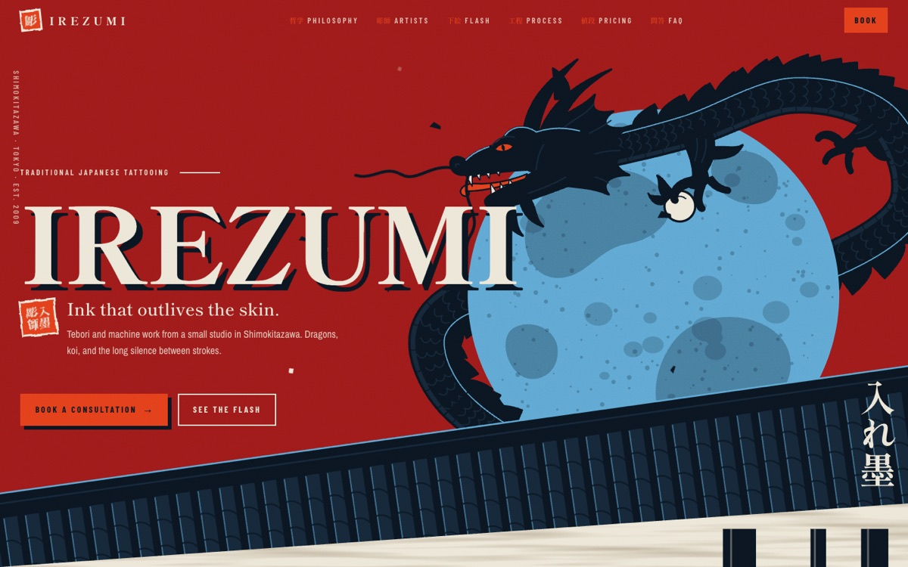
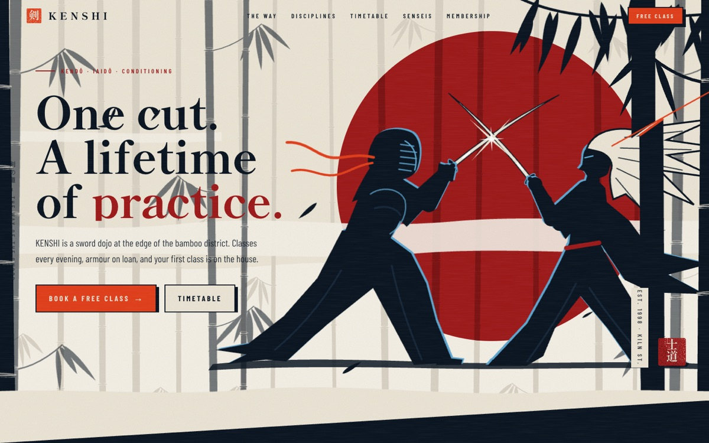
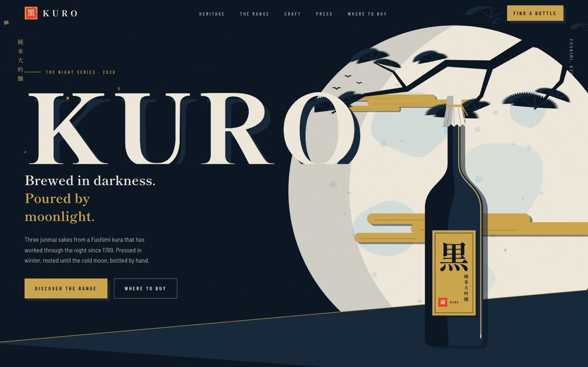
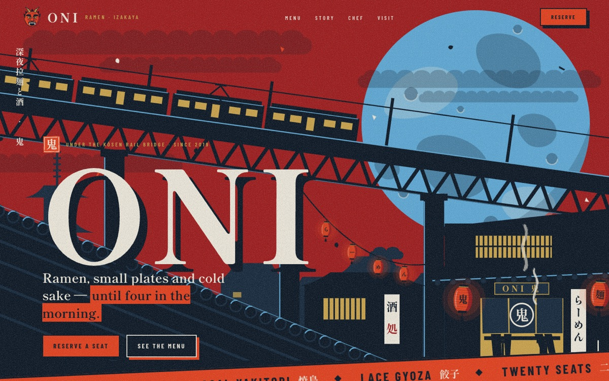
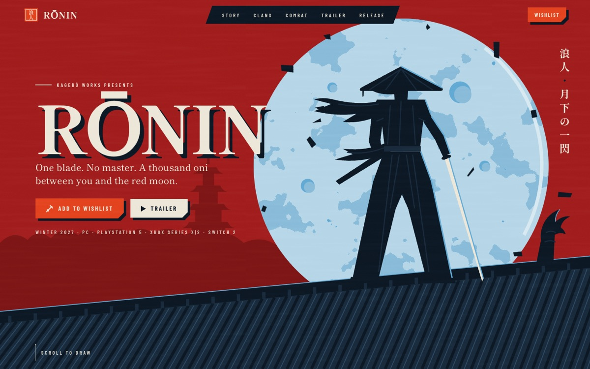

# ukiyo-landings

Five landing pages for made-up brands, all in one look: the Animatrix "Program" take on ukiyo-e. Flat
posterized color fields, a giant moon, tiled roofs, gold-leaf clouds and vermilion seals. I made them as
style studies alongside [`03-ronin`](../03-ronin), the portfolio in the same style.

Every brand, address, price and email here is fictional. All imagery is hand-built SVG in the components,
no raster art.

| Folder | Brand | Live |
|---|---|---|
| [`irezumi`](irezumi) | Japanese tattoo studio in Tokyo | [demo](https://ukiyo-irezumi.vercel.app) |
| [`kenshi`](kenshi) | Kendō / iaidō sword dojo with a free-trial booking form | [demo](https://ukiyo-kenshi.vercel.app) |
| [`kuro`](kuro) | Sake brewery, with an age gate | [demo](https://ukiyo-kuro.vercel.app) |
| [`oni`](oni) | Late-night ramen and izakaya under a rail bridge | [demo](https://ukiyo-oni.vercel.app) |
| [`ronin`](ronin) | Samurai action game, wishlist page | [demo](https://ukiyo-ronin.vercel.app) |











## Run

```bash
cd kuro            # any of the five
npm install
npm run dev
```

Stack for all five: Next.js 16 (App Router), Tailwind CSS v4, GSAP ScrollTrigger. Each folder has a
`PLAN.md` with the design brief it was built from.
